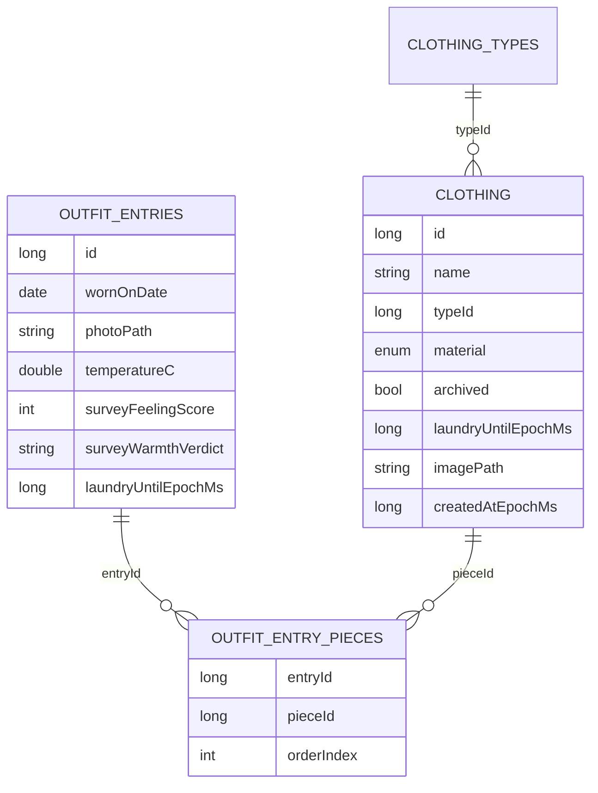

# Petrichor: Outfit Journal &amp; Smart Recommendations

Implementation plan for the remaining Petrichor features, written to be executed by an agentic AI developer. Read this document together with `2026-11-12-APP_OVERVIEW.md` (current state of the codebase) and `AGENTS.md` (binding project rules). This document only specifies **new or changed** behavior; everything else stays as described in `2026-11-12-APP_OVERVIEW.md`.

Last decision refresh: 2026-11-12.

---

## 0. How to use this document

- Sections are ordered roughly by build dependency, not by execution order. Section 12 gives the recommended implementation order and maps sections to Jira tickets.
- "MUST" / "always" / "never" statements are binding requirements. "Should" statements are strong defaults; deviate only with a comment explaining why.
- All product decisions in section 1 were confirmed by the product owner in an interview (2026-11-12). Do not re-litigate them; implement them as specified.
- Stick to the existing conventions (lightweight ViewModels constructed at call sites, one `MaterialSymbolsRenderingScope` in `App.kt`, repositories as business boundaries). Minimize new `expect`/`actual` declarations; every new one needs justification in a code comment.
- If the Kotlin Toolchain (the non-Gradle build system) blocks any part of this plan (quality tool integration, Room KSP for new entities, notification libraries), fall back to a Gradle migration as approved by the owner. Try the Kotlin Toolchain first.
- Start with the code quality tools first, then implement the rest.

## 1. Product decisions (authoritative)

All of the following were explicitly confirmed by the owner:

1. The "database page" is called **Journal**. It lists logged outfits, offers "add outfit", and gives access to each entry's survey.
2. Outfits can be logged **anytime** via the Journal's add action; the 8:00 notification is a shortcut to the same dialog, not the only entry point.
3. The morning **selfie is optional**. An outfit can be pieces-only.
4. Wardrobe pieces attach to an outfit via **free multi-select**. Arbitrary subsets are valid, including stacks like two t-shirts and a sweater. Each wardrobe piece can be selected at most once per outfit.
5. The evening survey asks **two required questions**: feeling score 1-5 and warmth verdict (too cold / perfect / too warm). Both must be answered to submit. Surveys can be **edited later** from the Journal.
6. The model predicts the **1-5 feeling score**. It is retrained **after every survey submission or edit**, in the background.
7. Training inputs: forecast/observed temperature plus coverage-zone warmth aggregation of the attached pieces (materials, types, layer counts) computed from past logged outfits.
8. Below **10 surveyed entries**, a heuristic based on warmth verdicts ranks recommendations. With **0 surveyed entries**, a weather-based textual fallback is shown ("Sweater" when cold, "T-shirt" when warm, per temperature bands). If the user already has wardrobe data, pick a random clothing item for each category.
9. Past logged outfits are recommended by **predicted score at the forecast temperature**. Each day shows a **top-3 of swipeable alternatives, if there is enough data available to generate that many alternatives**.
10. Recommendation display: if the outfit has attached pieces, show the pieces; otherwise show the **selfie**.
11. **Laundry**: a piece or a logged outfit can be marked "in the laundry" for **1 or 2 days** (user picks at mark time). Marking is possible from the wardrobe detail screen and directly from a recommendation; marking from a recommendation **regenerates the recommendation**.
12. Laundry filtering: a recommendation built from known pieces replaces only the laundry piece (best same-zone alternative); an outfit whose pieces are unknown (selfie-only entry) is skipped entirely while in the laundry.
13. **Archive instead of delete**: wardrobe pieces linked to at least one journal entry are soft-deleted (`archived = true`) when the user deletes them, silently. Archived pieces are visible **only inside journal entries**, and are excluded from all recommendations and pickers. Unlinked pieces are hard-deleted with their image as today.
14. **Tabs**: remove the Home and Settings placeholders, add Journal. Final tab order: Wardrobe, Journal, Suggestions, Weather. There is no settings surface anywhere; notification times are fixed.
15. **Notifications at fixed 8:00 and 20:00 local time, on Android and iOS only** (no-op on JVM/WASM). Tapping opens the app on the Journal tab with the corresponding dialog auto-opened.
16. If the 20:00 survey fires and no outfit was logged today, the survey flow lets the user **log an outfit first** (then continues to the survey).
17. With multiple entries on one day, the survey targets the **most recent un-surveyed entry of that day**.
18. Each logged entry **snapshots the weather** (temps + conditions) at logging time, so the model can train on it.
19. **Location bug**: the Suggestions/Recommendation screen must use the **Weather tab's selected location** (persisted and shared), not always the current location. When the user has chosen "use current location", current-location behavior remains.
20. **ImagePickerKMP rotate/crop features are disabled** everywhere.
21. **ktlint + detekt run automatically as part of every build. Use them when implementing.**
22. Room DB **destructive migration is acceptable** (existing wardrobe data need not be preserved).
23. Full-body pieces (dresses) are handled via **coverage zones**: a FULL\_BODY piece covers both the upper and lower warmth zones; candidate outfits are either "split" (upper + lower) or "full-body", never mixed (an outer layer over a full-body piece is allowed).
24. The Suggestions tab keeps the **calendar**, but the page opens to the recommendation; pulling down reveals the calendar.
25. Outfit structure is **dynamic**: an outfit is a variable list of pieces grouped by zone; groups render only when non-empty; a t-shirt-only outfit and a three-layer winter outfit both display naturally.

Delegated implementation choices (owner granted freedom): exact warmth weight constants, tab transitions, dialog layouts, ticket granularity, test structure, and all internal code design. Anything in this plan marked as a constant is tunable.

## 2. App shell changes

### 2.1 Tabs

`../shared/src/App.kt`: the `HorizontalPager` goes from 5 pages to 4:


| Tab # | Label       | Icon                    | Screen                                    |
| ----- | ----------- | ----------------------- | ----------------------------------------- |
| 0     | Wardrobe    | `CHECKROOM`             | `WardrobeScreen` (unchanged)              |
| 1     | Journal     | `BOOK` (or `EDIT_NOTE`) | `JournalScreen` (new, `ui/journal/`)      |
| 2     | Suggestions | `FOR_YOU`               | `RecommendationScreen` (reworked)         |
| 3     | Weather     | `CLOUD`                 | `WeatherScreen` (small change, section 8) |


Home and Settings placeholder screens and their `BoxMessage`s are deleted, if not done so already. All existing index-based code touching the pager must be re-checked (no deep links exist today, so impact should be local).

`JournalScreen` must short-circuit to a preview message under `LocalInspectionMode`, like the other screens.

### 2.2 Deep-link action bus (notification entry points)

New common singleton, no `expect`/`actual` needed:

```kotlin
// shared/src/ui/journal/JournalAction.kt
enum class JournalPendingAction { ADD_OUTFIT, SURVEY }

object JournalActionBus {
    private val _action = MutableStateFlow<JournalPendingAction?>(null)
    val action: StateFlow<JournalPendingAction?> = _action.asStateFlow()
    fun request(action: JournalPendingAction) { _action.value = action }
    fun consume() { _action.value = null }
}
```

`App.kt` collects `JournalActionBus.action`; when non-null it animates the pager to the Journal tab (`pagerState.animateScrollToPage(1)`) and passes the action down to `JournalScreen`, which opens the corresponding dialog in a `LaunchedEffect` and calls `consume()` when the dialog is dismissed or saved. Platform entry points (Android `MainActivity`, iOS notification delegate) call `JournalActionBus.request(...)` before/at composition; the common code handles the rest.

## 3. Data model &amp; persistence (Room)

New common package `../shared/src/data/outfit`. All entities live in common code with Room 3 multiplatform annotations, like the wardrobe entities.

### 3.1 Entities

```kotlin
// data/outfit/OutfitModels.kt
enum class WarmthVerdict { TOO_COLD, PERFECT, TOO_WARM }

@Entity(tableName = "outfit_entries")
data class OutfitEntry(
    @PrimaryKey(autoGenerate = true) val id: Long = 0,
    val wornOnDate: LocalDate,        // kotlinx-datetime LocalDate; stored as ISO "yyyy-MM-dd" via converter
    val photoPath: String?,            // optional selfie, stored via ClothingImageStorage
    val notes: String?,
    // weather snapshot (nullable: older manual entries may have no data)
    val temperatureC: Double?,
    val feelsLikeC: Double?,
    val minTempC: Double?,
    val maxTempC: Double?,
    val weatherDescription: String?,
    val weatherIcon: String?,
    val isRainy: Boolean,
    // survey (both null until surveyed; both set together)
    val surveyFeelingScore: Int?,      // 1..5
    val surveyWarmthVerdict: WarmthVerdict?,
    val surveyedAtEpochMs: Long?,
    // laundry (epoch ms until which this outfit is blocked; 0 = clean)
    val laundryUntilEpochMs: Long = 0,
    val createdAtEpochMs: Long = 0,
)

@Entity(
    tableName = "outfit_entry_pieces",
    primaryKeys = ["entryId", "pieceId"],
    foreignKeys = [
        ForeignKey(entity = OutfitEntry::class, parentColumns = ["id"],
                   childColumns = ["entryId"], onDelete = ForeignKey.CASCADE),
        ForeignKey(entity = ClothingPiece::class, parentColumns = ["id"],
                   childColumns = ["pieceId"], onDelete = ForeignKey.RESTRICT),
    ],
    indices = [Index("entryId"), Index("pieceId")],
)
data class OutfitEntryPiece(
    val entryId: Long,
    val pieceId: Long,
    val orderIndex: Int = 0,
)

data class OutfitEntryWithPieces(
    @Embedded val entry: OutfitEntry,
    @Relation(parentColumn = "id", entityColumn = "id",
        associateBy = Junction(OutfitEntryPiece::class,
            parentColumn = "entryId", entityColumn = "pieceId"))
    val pieces: List<ClothingPiece>,
)
```

`ClothingPiece` gains two columns (migration-safe defaults):

```kotlin
val archived: Boolean = false,
val laundryUntilEpochMs: Long = 0,   // 0 = clean
```

Model state table (coefficients live in the DB, which avoids a new DataStore expect/actual):

```kotlin
@Entity(tableName = "model_state")
data class ModelState(
    @PrimaryKey val id: Long = 1,        // singleton row
    val coefficientsJson: String,        // kotlinx-serialization List<Double>
    val trainedAtEpochMs: Long,
    val sampleCount: Int,
)
```

`WardrobeConverters` gains a `WarmthVerdict` converter (by name; unknown value throws, consistent with supertype behavior) and a `LocalDate` converter (`LocalDate.toString()` to store, `LocalDate.parse` to read). ISO "yyyy-MM-dd" strings sort lexicographically, so `ORDER BY wornOnDate DESC` and date-equality queries keep working unchanged.

### 3.2 ER overview



### 3.3 DAO and database

`WardrobeDatabase` bumps `version = 2` and adds the three new entities. Use `fallbackToDestructiveMigration(true)` on the builder in every platform actual (owner approved destructive migration; no hand-written migration is needed). `exportSchema` stays disabled.

New `OutfitDao`:

- `getAll(): Flow<List<OutfitEntryWithPieces>>` ordered by `wornOnDate DESC, createdAtEpochMs DESC`
- `getForDate(date: LocalDate): Flow<List<OutfitEntryWithPieces>>`
- `getUnsurveyedForDate(date: LocalDate): List<OutfitEntryWithPieces>` (surveyFeelingScore IS NULL), ordered by `createdAtEpochMs DESC` (most recent first)
- `getById(id: Long): OutfitEntryWithPieces?`
- `getEntriesForPiece(pieceId: Long): List<OutfitEntry>` (archive decision)
- `countSurveyed(): Flow<Int>`
- `insertEntry(entry): Long`, `insertEntryPieces(links)`, `updateEntry(entry)`, `deleteEntry(entry)`
- `setSurvey(entryId, score, verdict, surveyedAtEpochMs)`
- `setLaundryUntil(id, untilEpochMs)`
- `clearEntryPieces(entryId)` (for edits, then re-insert)

`ClothingDao` changes:

- `getAll` (and `getByType`) gain `WHERE archived = 0`
- new `getByIdIncludingArchived(id)` for Journal display and delete logic
- new `setArchived(id, archived)` and `setLaundryUntil(id, untilEpochMs)`

### 3.4 Repositories

New `OutfitLogRepository` (business boundary, mirrors `WardrobeRepository` style):

- `entries: Flow<List<OutfitEntryWithPieces>>` (via DAO)
- `logOutfit(entry, pieces)`: stamps `createdAtEpochMs = Clock.System.now().toEpochMilliseconds()` when 0 (same timestamp rule as wardrobe), persists entry + links in a transaction, all under `withContext(ioDispatcher)`
- `saveSurvey(entryId, score, verdict)`: updates the entry, sets `surveyedAtEpochMs`, then triggers model retrain (section 6.6)
- `markOutfitLaundry(entryId, days)`, `markPieceLaundry(pieceId, days)`: `until = now + days*24h` (day granularity is fine)
- `deleteEntry(entry)`: deletes the entry and removes the selfie file via `ClothingImageStorage.deleteImage`
- `mostRecentUnsurveyedToday(): OutfitEntryWithPieces?`

`WardrobeRepository` gains:

- `deletePieceWithArchive(piece)`: if `outfitDao.getEntriesForPiece(piece.id).isNotEmpty()` then `clothingDao.setArchived(piece.id, true)` (image files are kept, needed by Journal display); else hard delete + `ClothingImageStorage.deleteImage` as today
- `markLaundry(pieceId, days)` and `pieceIsInLaundry(piece)` helpers (state derived as `laundryUntilEpochMs > now`)

Snackbar flow in `WardrobeViewModel` stays; delete just calls the new repository method.

Selfie storage reuses `ClothingImageStorage` as-is (paths, load, delete). No rename; a short comment notes journal selfies share the storage.

### 3.5 Weather snapshot at logging time

`JournalViewModel` (section 5) exposes current weather for the shared selected place. On save:

- worn day == today: store current temperature, feels-like, today's forecast min/max, description, icon, and `isRainy` (same rain detection as `OutfitRecommendation.kt` today: description contains "rain" or icon prefix `09/10/11`)
- worn day is a future day covered by the 5-day forecast: store that `ForecastDay`'s min/max and icon; current-temp fields null
- otherwise (older manual back-entries): store all-null weather fields and `isRainy = false`; the entry is excluded from training (section 6)

## 4. Wardrobe changes

1. **Archive instead of delete** (decision 13): `WardrobeViewModel.deleteClothing` routes to `WardrobeRepository.deletePieceWithArchive`. No confirmation change, no copy change, archive happens silently. The wardrobe grid, type filter, and add-outfit piece picker never show archived pieces (they all go through `getAll`/`getByType`, which now filter). The wardrobe detail screen does not need changes for archived pieces because archived pieces are unreachable from the wardrobe UI.
2. **Laundry**: the clothing detail screen (`ClothingDetailScreen`) gets an overflow action "Mark in laundry" opening a small chooser: "For 1 day" / "For 2 days". While a piece is in the laundry, the detail screen shows a "In laundry until &lt;d MMM&gt;" row. (Marking from recommendations happens on the Suggestions tab, section 7.)
3. **ImagePickerKMP**: change every `CropConfig` in the codebase to `CropConfig(enabled = false)` (first: `AddClothingDialog`), and use the same disabled config for the new selfie picker. After this, the `isImageCropAvailable` expect/actual and its platform actuals are dead code: delete them (minimizes expect/actual). Any rotate/edit affordance from the picker must not appear; if imagepickerkmp exposes a separate rotate option it must be left off. EXIF-based auto-orientation on Android/iOS stays (that is loading correctness, not an editing feature).

## 5. Journal tab

New package `../shared/src/ui/journal`. Follows the Wardrobe tab's state-ownership pattern: `JournalScreen` owns dialog visibility, selected entry, snackbar state; `JournalViewModel` is a lightweight class created with `remember` at the call site, exposing repository flows and suspend actions with error surfacing via a `snackbarMessage`.

### 5.1 JournalScreen

- `LazyColumn` of all entries (newest first), each row: selfie thumbnail (or `IMAGE` symbol), date, piece chips (piece name; archived pieces get an "archived" suffix chip style, e.g. grey + `LOCK` symbol), survey status chip ("Survey pending" or "4/5 - Perfect"), "In laundry until &lt;date&gt;" indicator when active.
- FAB "Add outfit" (`ADD` symbol) opening `AddOutfitDialog`.
- Tap on an entry opens `OutfitDetailSheet`.
- Consumes `JournalPendingAction` from `JournalActionBus` (section 2.2): `ADD_OUTFIT` opens `AddOutfitDialog` for today; `SURVEY` opens the survey flow for `mostRecentUnsurvedToday()`, or the "log outfit first" flow when none exists (section 5.4).

### 5.2 AddOutfitDialog (add and edit)

One dialog component, `outfit == null` means add (same pattern as `AddClothingDialog`):

- **Date**: a `LocalDate` defaulting to today, shown as "&lt;weekday&gt; &lt;d MMM&gt;"; stepper arrows +/- 1 day via `LocalDate.plus(days)` (bounded to past 366 days / future 5 days).
- **Selfie (optional)**: `rememberImagePickerKMP` with `GalleryConfig(allowMultiple = false)` plus camera when `isCameraAvailable()`, `CropConfig(enabled = false)`. Preview, "Select photo", "Replace photo", "Remove photo".
- **Pieces (optional, free multi-select)**: list of non-archived wardrobe pieces grouped by clothing type with checkbox rows; each piece selectable once; arbitrary subsets valid (two t-shirts = two distinct t-shirt pieces; no structural validation, no warnings). Selected count shown.
- **Notes** (optional, multiline).
- On save: weather snapshot per section 3.5, `logOutfit` or `updateEntry` (edit clears and re-inserts piece links and deletes a removed photo file). Save errors keep the dialog open (same rule as `AddClothingDialog`).

### 5.3 OutfitDetailSheet

Full-screen overlay reusing the visual pattern of `ClothingDetailScreen` (slide+fade `AnimatedVisibility`, exit animation completes before selection clears, `BackHandler` closes):

- Hero selfie (or placeholder), date, notes.
- Pieces list: chips/cards, including archived pieces (marked).
- Weather snapshot block: temperature, min/max, description (rendered only when data exists).
- Survey section: either the recorded "4/5 - Perfect" with an "Edit survey" button, or "Fill in survey" button, both opening `SurveyDialog`.
- Overflow menu: "Mark outfit in laundry" (1 or 2 days chooser), "Delete entry" (confirm dialog), "Edit" (reopens `AddOutfitDialog` in edit mode).

### 5.4 SurveyDialog

- Title: "How did it go today?"
- Question 1 (required): "How did you feel in this outfit?" with a 1-5 picker (five large buttons labeled 1..5, or a slider; pick one and apply it consistently).
- Question 2 (required): "Was it too cold, perfect, or too warm?" with a three-option segmented control.
- Submit disabled until both are answered. Submit calls `OutfitLogRepository.saveSurvey`, which triggers retraining, then closes and shows a snackbar.
- Empty-state variant (only via the 20:00 deep link when today has no un-surveyed entry): "You haven't logged an outfit yet today." with a primary button "Log outfit first" that opens `AddOutfitDialog` (today preset); after saving, `SurveyDialog` reopens automatically targeting the new entry.

## 6. Recommendation engine

Reworks `data/recommendation/`. The old `OutfitRecommendation` five-layer model is replaced by zone-based groups; `recommendOutfit` placeholder logic is deleted (it is the TODO at `OutfitRecommendation.kt:52`).

### 6.1 Coverage zones

```kotlin
enum class CoverageZone { HEAD, UPPER, LOWER, FEET }
```

A piece covers zones derived from its supertype:


| Supertype   | Zones covered                                                                     |
| ----------- | --------------------------------------------------------------------------------- |
| HEADWEAR    | HEAD                                                                              |
| UPPER\_BODY | UPPER                                                                             |
| LOWER\_BODY | LOWER                                                                             |
| FULL\_BODY  | UPPER and LOWER (a dress covers both; the pair is treated as one structural unit) |
| FOOTWEAR    | FEET                                                                              |
| ACCESSORIES | none (displayed but warmth-neutral)                                               |


### 6.2 Warmth encoding

Constants (tunable, defined in one file with a comment saying so):

- Material warmth `W_M`: WOOL 1.00, LEATHER 0.80, COTTON 0.60, POLYESTER 0.50, MIX 0.50, UNKNOWN 0.50, SILK 0.40, LINEN 0.20
- Type warmth `W_T` by type name (built-ins): Jackets 1.00, Hoodies 0.85, Sweaters 0.75, Jeans 0.60, Pants 0.55, Shirts 0.40, T-Shirts 0.30, Dresses 0.90, Sneakers 0.30, Caps 0.30; custom types fall back to per-supertype defaults (UPPER\_BODY 0.50, LOWER\_BODY 0.50, FULL\_BODY 0.80, FOOTWEAR 0.30, HEADWEAR 0.30)

Per piece: `warmth(piece) = W_M(piece.material) * W_T(piece.typeName)`. Per zone: sum over covering pieces. An outfit's feature vector (temperature uses `(min + max) / 2` of the forecast day, or the snapshot min/max for training entries):

```
x = [1.0, tempC, warmthUpper, warmthLower, warmthHead, warmthFeet, layerCountUpper, isRainy]
```

where `layerCountUpper` counts pieces covering UPPER (captures "two t-shirts and a sweater" stacks). This is the encoding for training, prediction, and the heuristic.

### 6.3 Candidate generation

Inputs: non-archived, non-laundry wardrobe pieces; all logged outfits; the forecast weather for the selected day. Candidates are either:

- **Logged outfit candidates**: entries whose pieces are all non-archived. Entries containing a piece currently in the laundry have that piece **replaced** by the best-scoring same-zone alternative (below); selfie-only entries (no attached pieces) are **skipped entirely** while the entry itself is in the laundry (decision 12). Selfie-only entries that are clean are valid candidates (displayed as their selfie).
- **Constructed candidates** from wardrobe pieces: choose per zone with a bounded enumeration. For the forecast temperature, order pieces per zone by warmth suitability (cold: high warmth first; warm: low warmth first) and take top-K (K: 3 upper base pieces, 2 outer pieces, 3 lower pieces, 2 full-body pieces, 1 headwear, 1 footwear). Cross-product, but:
  - a candidate is either **split** (one upper base, optionally one outer piece, one lower piece) or **full-body** (one full-body piece, optionally one outer piece over it), never mixed (decision 23)
  - include an outer piece only when `tempC < 14`
  - cap constructed candidates at 60 (score-ordered truncation after scoring)
- Piece replacement for laundry: pick from the same zone, non-archived, non-laundry, maximizing the candidate's score. If no alternative exists, remove the zone from the candidate (e.g., recommend the outfit without headwear) rather than skipping it, except UPPER and LOWER where no alternative means skip the candidate.

### 6.4 Scoring modes

- **Model mode (&gt;= 10 surveyed training entries with temperature data)**: predict the feeling score with the trained linear model, clamp to \[1, 5\]. Rank descending.
- **Heuristic mode (1-9 surveyed entries)**: compute an ideal torso warmth `idealWarmth(tempC)` for the forecast temperature from verdict data: linear interpolation (or nearest-neighbor with 1 point) of `warmthUpper + warmthLower` over temperature among PERFECT entries; if fewer than 2 PERFECT entries exist, take the midpoint between the nearest TOO\_COLD entry's warmth (lower bound) and the nearest TOO\_WARM entry's warmth (upper bound) at that temperature; add `0.3` when `isRainy`. Score = `5 - min(4, |warmthUpper + warmthLower - idealWarmth(tempC)|)` (after laundry replacement, using the candidate's own zones). Headwear/feet do not affect heuristic distance (they are display extras).
- **Fallback mode (0 surveyed entries)**: no ranking is possible. Show the existing per-group textual `generalSuggestion`, upgraded to temperature bands: below 5°C "Winter jacket, sweater and long pants"; 5-12°C "Sweater and long pants"; 12-18°C "Long-sleeved shirt or light sweater"; 18-24°C "T-shirt or shirt"; above 24°C "T-shirt, shorts if you like".

The active mode is derived from `countSurveyed()` and exposed for tests. Return top-3 distinct candidates (no duplicate piece sets), ties broken in favor of logged outfits (real history beats constructed). When fewer than 3 candidates exist, return what exists.

### 6.5 Common result model

```kotlin
enum class RecommendationSource { MODEL, HEURISTIC, FALLBACK }

data class OutfitCandidate(
    val loggedEntry: OutfitEntry?,     // null => constructed from wardrobe
    val pieces: List<ClothingPiece>,   // resolved, includes replacements; empty for selfie-only
    val selfiePath: String?,           // from loggedEntry, if any
    val generalSuggestion: String?,    // FALLBACK mode only
    val source: RecommendationSource,
)

data class OutfitGroup(val zone: CoverageZone, val label: String, val pieces: List<ClothingPiece>)
```

Display groups are derived from `pieces` in a fixed order: Headwear, Upper body, Lower body, Full body, Footwear; a full-body piece produces a "Full body" group and suppresses Upper/Lower groups; **groups with no pieces are omitted** (decision 25). Accessories, if selected, appear under a "Accessories" group.

### 6.6 Linear regression (common Kotlin, no ML library)

- Pure common object `LinearRegression`: ordinary least squares with ridge regularization (lambda 0.5), normal equations solved by Gaussian elimination with partial pivoting. Features as in 6.2 (8 coefficients).
- Training set: surveyed entries with temperature data (`minTempC`/`maxTempC` present, or `temperatureC` fallback). Target: `surveyFeelingScore`.
- Trigger: `OutfitLogRepository.saveSurvey` and every survey edit, plus entry deletion (shrinking data), launched in the background on an application-level `CoroutineScope(SupervisorJob() + ioDispatcher)` singleton owned by the repository layer (consistent with the no-DI style). Retraining also happens lazily at app start if `model_state.trainedAtEpochMs` is older than the newest survey.
- Persistence: single `model_state` row, coefficients as JSON (kotlinx-serialization, already a dependency).
- Prediction: `LinearRegression.predict(coefficients, features)` clamped to \[1, 5\].

## 7. Suggestions tab rework

`ui/recommendation/RecommendationScreen.kt`:

1. **Layout**: root becomes a `LazyColumn` with two items: (0) the existing `RecommendationCalendar`, (1) the recommendation content (`LocationNote` + top-3). On first composition the list state scrolls to item 1 (`LaunchedEffect` with a `rememberSaveable` "already scrolled" guard so restored state is preserved) so the recommendation is visible immediately and the calendar appears on scroll up (decision 24).
2. **Content**: `HorizontalPager` over the top-3 `OutfitCandidate`s, reusing the swipeable-card feel of `SwipeableClothingSlot` (pagination dots can stay). Per page:
  - If `pieces` is non-empty: render the dynamic groups (6.5) as labeled horizontal rows of `ClothingCard`s.
  - Else if `selfiePath` is non-empty: one large selfie card.
  - Else: a `RecommendationSlotCard` with the textual suggestion.
3. **Laundry actions**: each piece card has a long-press or overflow action "Mark in laundry" (1 or 2 days chooser). After marking, the recommendation list recomputes immediately: the engine is re-run and the list replaces the affected candidate (decision 11). Logged-outfit pages also offer "Mark outfit in laundry" in an overflow; constructed candidates do not (no persistent identity).
4. **Recomputation triggers**: selection date change, weather reload, wardrobe flows, and a `laundryVersion` counter exposed as a `StateFlow<Int>` by the repository (bumped on every laundry mark) included in the `remember(...)` keys.
5. **Location** (bug fix, decision 19): the screen collects the shared selected place (section 8); when null it resolves the current place as today. It no longer calls the location detector when a selection exists.
6. `RecommendationController` keeps its shape (lightweight ViewModel, flows); it gains the candidates flow and the laundry actions. Keep `calendar_pager` test tags and the nested-scroll connection working.

## 8. Shared location fix (bug)

New small repository next to the existing location data:

```kotlin
// data/location/SelectedLocationStore.kt
class SelectedLocationStore(dataStore: DataStore<Preferences>) {
    val selectedPlace: Flow<Place?>      // null = use current location
    suspend fun select(place: Place)
    suspend fun clear()                  // "Use current location"
}
```

- Storage: one preference key `selected_place` in the existing `saved_locations` DataStore (created by `createLocationDataStore()`), value = JSON of `Place` (kotlinx-serialization; `Place` is not `@Serializable`, so either annotate it or serialize a `LocationResult`-style DTO and map).
- `WeatherScreen` replaces its local `selectedPlace` state with this store: picker selections call `select`, "Use current location" calls `clear`, and the LaunchedEffect only resolves `currentPlace()` when the flow emits null. Behavior is otherwise unchanged.
- `RecommendationScreen`/`RecommendationController` uses the same flow (section 7.5).

## 9. Notifications (Android + iOS)

Fixed daily reminders, no settings UI, no-op on JVM/WASM (decision 14/15).

### 9.1 Common surface

One `expect` with three no-op actuals is acceptable (JVM/WASM) plus real Android/iOS actuals:

```kotlin
// shared/src/platform/NotificationScheduler.kt (expect)
expect object NotificationScheduler {
    /** Schedules or reschedules both daily reminders. Idempotent. */
    fun scheduleDailyReminders()
}
```

Pure common helper computes the next occurrence times (test it):

```kotlin
object ReminderTimes {
    const val MORNING_HOUR = 8
    const val EVENING_HOUR = 20
    fun nextOccurrence(now: Instant, hour: Int, zone: TimeZone): Instant
}
```

### 9.2 Android

- WorkManager (`androidx.work:work-runtime-ktx`, add to `androidApp`/`shared` android deps as the toolchain requires): two `PeriodicWorkRequest` (24 h interval), initial delay to the next 8:00 / 20:00 local time, unique names `journal_morning` / `journal_evening`, replaced on every app start (`ExistingWorkPolicy.REPLACE`).
- The worker posts a notification on channel `journal_reminders` (created at app start): 8:00 "Log today's outfit" / "Take a selfie or pick your pieces."; 20:00 "How did it feel today?" / "Fill in your evening survey."
- Tap intent: `PendingIntent` to `MainActivity` with extras `journal_action = add_outfit | survey`, distinct request codes, `FLAG_IMMUTABLE` or `FLAG_UPDATE_CURRENT` as appropriate; `MainActivity` (singleTop) reads the extra in `onCreate`/`onNewIntent` and calls `JournalActionBus.request(...)` before composition resumes.
- Permission: request `POST_NOTIFICATIONS` at first launch (Android 13+); if denied, workers still run but silently post nothing. Manifest gains the permission declaration.

### 9.3 iOS

- `UNUserNotificationCenter`: request authorization (alert + sound) once on first launch of `ViewController`; schedule two `UNCalendarNotificationTrigger` with `DateComponents(hour: 8/20, minute: 0)`, `repeats: true`, identifiers `journal.add_outfit` / `journal.survey`; remove and re-add both on every app start.
- `userInfo` carries `"action": "add_outfit" | "survey"`. The notification delegate (on the ViewController / app delegate) calls `JournalActionBus.request(...)`; cold start reads the launch response the same way.

## 10. Tooling: ktlint + detekt on every build

Requirement (decision 21): `./kotlin build` (and `./kotlin test`) must run ktlint and detekt and **fail** on violations. Reference documentation: [https://kotlinlang.org/docs/jvm-code-analysis.html](https://kotlinlang.org/docs/jvm-code-analysis.html).

1. Add pinned versions of ktlint and detekt compatible with the project's Kotlin version (use the versions recommended by that page at implementation time).
2. Configuration in the repo root: `../.editorconfig` for ktlint; `detekt.yml` starting from the default config. Keep the default rule sets; do not disable formatting rules wholesale. Where ktlint and detekt `formatting` overlap, let ktlint own formatting and disable the overlapping detekt formatting rules.
3. Wire into the build via the Kotlin Toolchain's native mechanism for custom tasks/hooks if one exists (inspect the toolchain docs; declare it in `../project.yaml` or as a module task). If the toolchain cannot host them, the accepted fallback is to run them inside the build wrapper flow, but the acceptance criterion is fixed: `./kotlin build` fails on violations. If neither works, this counts as "the build system gives trouble": execute the approved Gradle migration (add a minimal Gradle setup mirroring the module layout, or convert fully), with ktlint/detekt as standard JVM tooling tasks.
4. Baseline: fix all violations in the existing code within this change so the build is green from the first commit of this work. Do not carry a large suppression baseline; targeted `@Suppress` only with a comment.
5. New code from sections 2-9 must pass both tools by construction.

## 11. Testing

Follow the existing patterns (`../shared/test` with fakes, `shared/test@jvm/ui` Compose tests asserting semantics, never animation timing; test-only `MaterialSymbolsRenderingScope`).

**Data (common)**

- `OutfitLogRepositoryTest` with a hand-written `FakeOutfitDao` (MutableStateFlow-backed, like `FakeClothingDao`): createdAt stamping, survey save + retrain trigger, archive-vs-delete decision (linked piece archived and image kept; unlinked piece hard-deleted and image removed), laundry until computation, weather snapshot fields.
- `WarmthEncodingTest`: zone sums, FULL\_BODY covers both zones, custom type fallbacks, layer counts.
- `LinearRegressionTest`: exact recovery of a known linear function on synthetic data; degenerate/collinear inputs stay finite thanks to ridge; clamping.
- `HeuristicTest`: hand-computed rankings with small fixture verdict sets; perfect-interpolation and no-perfect fallback paths.
- `CandidateGeneratorTest`: split/full-body exclusivity, laundry replacement picks same-zone alternative, archived exclusion, selfie-only laundry skip, candidate caps.
- `ReminderTimesTest`: next-8:00 across midnight, month, and DST boundaries.

**UI (JVM, `runDesktopComposeUiTest`)**

- Journal list renders entries with survey and laundry chips.
- SurveyDialog submit disabled until both answers chosen.
- AddOutfitDialog piece multi-select toggles; save calls through (fake repository).
- Suggestions tab shows the top-3 pager with dynamic groups (fixed fake wardrobe, fixed `today`), opens scrolled below the calendar.

## 12. Implementation order and Jira mapping

Recommended order (each phase ends with `./kotlin build` and `./kotlin test` green, ktlint/detekt included):


| #   | Workstream                                                                     | Sections    | Jira                                                                      |
| --- | ------------------------------------------------------------------------------ | ----------- | ------------------------------------------------------------------------- |
| 0   | Quality baseline: ktlint + detekt on every build                               | 10          | PET-37                                                                    |
| 1   | Room v2 data model, repositories, archive, laundry, weather snapshots          | 3, 4        | PET-38 (data model), PET-39 (archive), PET-40 (laundry), PET-10 (updated) |
| 2   | Tab restructure + shared location fix                                          | 2.1, 8      | PET-42 (tabs), PET-41 (location bug)                                      |
| 3   | Journal tab: list, add/edit dialog, detail sheet, survey dialog, crop disabled | 2.2, 4.3, 5 | PET-30 (updated), PET-31 (updated), PET-43 (crop off)                     |
| 4   | Notifications and deep links                                                   | 9           | PET-29 (updated)                                                          |
| 5   | Recommendation engine + Suggestions tab rework                                 | 6, 7        | PET-44 (engine), PET-28 (updated)                                         |


All tickets live under epic **PET-36 "Outfit Journal &amp; Smart Recommendations"** on the Petrichor board (project PET), carry the `outfit-journal` label, and embed acceptance criteria distilled from this plan. PET-35 ("Nicer UI for outfits") stays as a final visual-polish pass over the Journal and Suggestions components once PET-30 and PET-28 land. Bugs found during implementation that are out of this plan's scope get their own tickets rather than scope creep.

## 13. Out of scope (explicitly)

- Settings UI of any kind (no notification time configuration).
- Real geolocation on JVM (fallback place stays).
- Weather/location caching between loads.
- Thumbnail downscaling (`thumbnailPath` keeps mirroring `imagePath`).
- Room schema export and a migration story beyond destructive fallback.
- Internationalization (hardcoded English strings, consistent with the current codebase).
- Reordering suggestions by user feedback beyond the model's own predictions.
