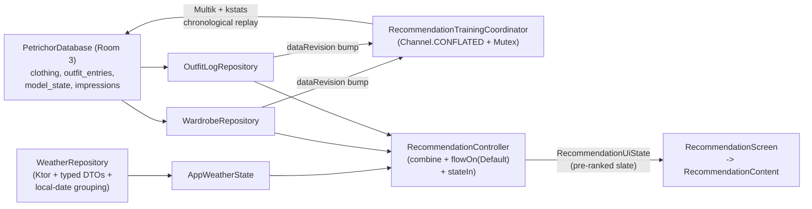

# Petrichor: Outfit Recommendation Implementation Plan

Implementation steps plan derived from [2026-11-17-RECOMMENDATION-RESEARCH.md](2026-11-17-RECOMMENDATION-RESEARCH.md), aligned with [AGENTS.md](../AGENTS.md) and the writing, architectural, and testing conventions of the `wardrobe` feature (`shared/src/data/wardrobe/`, `shared/src/ui/wardrobe/`, `shared/test/data/wardrobe/`, `shared/test@jvm/ui/wardrobe/`).

Plan date: 19 November 2026. Target platforms: `jvm`, `android` (`minSdk 26`), `iosArm64`, `iosSimulatorArm64`, `wasmJs` (built with Kotlin Toolchain / Amper `0.13.0`). All learning remains local to the user's device.

---

## 0. How to use this document

- **Binding rules**: "MUST" / "always" / "never" statements are binding. "Should" statements are strong defaults; deviate only with a brief code comment explaining why.
- **Language**: Use **British English** across prose, KDoc, comments, and new user-facing copy (per `AGENTS.md`). Exact library coordinates and Kotlin/API identifiers keep their upstream spelling (for example `kotlinx.serialization`).
- **Execution order**: Follow Phases 0 to 5 sequentially. Each phase ends with `./kotlin test -m shared -p jvm -p android`, `./kotlin build -m desktopApp -m androidApp`, `./kotlin build -m webApp -p wasmJs -v release`, and the ktlint/detekt gates green.
- **No premature commits**: Do not commit unless explicitly instructed. When committing, follow `AGENTS.md` (header ≤ 56 characters, blank line, body lines ≤ 72 characters).
- **Zero new `expect`/`actual` declarations**: Every component in this plan lives in `shared/src/` (`commonMain`). Do not introduce platform-specific math or ML bindings.
- **Product decision gates**: Two product decisions flagged in the research paper are kept behind explicit gates (Section 1.2) so Phases 1–2 can ship without altering existing product contracts.

---

## 1. Conventions and product boundaries

### 1.1 Architectural and writing conventions (wardrobe & `AGENTS.md`)

All new and modified code MUST mirror the established `wardrobe` conventions:

1. **Repository as business boundary** (mirrors `WardrobeRepository.kt`):
   - Constructor-inject DAOs and dependencies with default production values (`defaultOutfitDao()`, `defaultClothingDao()`, `ioDispatcher: CoroutineDispatcher = Dispatchers.Default`), keeping the project's no-DI style.
   - Dispatch all database and computation mutations off the UI thread via `withContext(ioDispatcher)` (or a dedicated injected `computeDispatcher: CoroutineDispatcher = Dispatchers.Default`, satisfying detekt's `InjectDispatcher` rule).
   - Expose reactive reads as `Flow` / `StateFlow`, and use monotonically increasing version counters (`StateFlow<Int>`) where UI recomputation must react to non-row-shape changes.
   - Keep pure domain helpers (warmth encoding, feature scaling, candidate construction, scoring, Bayesian updates) free of DAO, Compose, or platform imports so they are directly unit-testable in `shared/test/`.
2. **Screen and ViewModel separation** (mirrors `WardrobeScreen.kt`, `WardrobeFilterBar.kt`, `ClothingDetailScreen.kt`, `AddClothingDialog.kt`):
   - Keep a single `MaterialSymbolsRenderingScope` in `shared/src/App.kt` (never add another in production screens).
   - Instantiate lightweight `ViewModel`s at the call site with `viewModel { ... }`, surfacing repository failures as `snackbarMessage` while always rethrowing `CancellationException`.
   - Keep screen-level state (selected date, dialog visibility, snackbar host) in the screen composable (`RecommendationScreen`), and pass immutable UI state plus callbacks into stateless, testable content composables (`RecommendationContent`, `CandidatePager`, `SurveyDialog`). Child display components report user intent via callbacks and never filter or rank data internally (matching `WardrobeFilterBar`).
   - Short-circuit screens under `LocalInspectionMode.current` with `BoxMessage`.
   - Preserve clothing detail screen state across tab switches and keep its opening/closing animations untouched (`AGENTS.md`).
   - When adding optional garment attributes (Phase 4), reuse the shared add/edit `AddClothingDialog` with safe defaults so add mode requires only clothing type and edit mode preserves existing values.
3. **Testing conventions** (mirrors `WardrobeRepositoryTest.kt` and `shared/test@jvm/ui/wardrobe/`):
   - Place data, repository, model, and evaluation tests in `shared/test/data/recommendation/`, `shared/test/data/outfit/`, and `shared/test/data/weather/`.
   - Use hand-written `MutableStateFlow`-backed fakes (`FakeOutfitDao`, `FakeClothingDao`) so common tests never depend on platform Room drivers, network sockets, or image storage.
   - Place JVM Compose UI tests in `shared/test@jvm/ui/recommendation/` (and `wardrobe/` / `journal/` for Phase 4–5 UI additions), using `runDesktopComposeUiTest`, wrapping content in `MaterialSymbolsRenderingScope`, and asserting user-visible semantics and callbacks rather than animation timing.
4. **Code quality & Room conventions**:
   - Keep all files compliant with `detekt.yml` (`LongMethod ≤ 60`, `LongParameterList ≤ 6`, `TooManyFunctions ≤ 11`, `ReturnCount ≤ 2`, `ArrayPrimitive`, `MaxLineLength ≤ 140`, no `TODO:`/`FIXME:`). Any `@Suppress` MUST carry an inline justification comment.
   - Centralise tunable model and warmth constants in dedicated objects with clear comments.
   - Room schema bumps increment `PetrichorDatabase` `version` (currently `2`), relying on the owner-approved `fallbackToDestructiveMigration(true)` already configured on every platform builder.

### 1.2 Product decisions and gates

- **Retained during Phases 1–2**: The active ranking objective remains the predicted 1–5 feeling score (plan decision 6 in `2026-11-12-IMPLEMENTATION_PLAN.md`), so Phase 1 correctness fixes and the Phase 2 interaction ridge baseline can be compared apples-to-apples against the current model.
- **Gate A — Historical garment-metadata edit policy (Phase 1)**: Editing a garment's material, type, or weather-protection attribute is treated as *correcting* that garment's properties across history and increments the training data revision so the coordinator rebuilds the model cleanly. Entries also record a lightweight `featureSchemaVersion` in `ModelState` so stale artefacts are never decoded against a changed encoding.
- **Gate B — Combined thermal + feeling ranking policy (end of Phase 3)**: Switching the default user-facing ranking from pure 1–5 predicted feeling to "prefer high probability of `PERFECT` thermal comfort, then break ties with predicted 1–5 feeling" changes product decision 6. Phase 3 runs the Bayesian ordinal thermal model in **shadow mode** alongside the rating model and records offline/prospective metrics; flipping the default ranking policy requires explicit owner sign-off after Phase 3 evidence.

---

## 2. KMP library and established-method research

Every dependency and numerical method below was researched against Maven Central metadata (`.module` and `.pom` files) and verified against Petrichor's five targets (`jvm`, `android` with `minSdk 26`, `iosArm64`, `iosSimulatorArm64`, `wasmJs`) and Kotlin Toolchain `0.13.0`.

### 2.1 Libraries to adopt or leverage

| Capability | Chosen KMP library & version | Verified target support | Why this library is used |
| --- | --- | --- | --- |
| Dense linear algebra & linear system solving (`dot`, `solve`, `qr`, `plu`, `norm`) | **`org.jetbrains.kotlinx:multik-kotlin:0.3.1`** (Apache-2.0, JetBrains; transitively pulls `multik-core:0.3.1`) | `jvm` (consumed by Android), `iosArm64`, `iosSimulatorArm64`, `wasmJs` (built with `kotlin-stdlib:2.3.20`) | Replaces the hand-rolled normal-equation Gaussian elimination in `LinearRegression.kt` with JetBrains' official KMP multidimensional array library (`D1Array`/`D2Array` + PLU `mk.linalg.solve` and `mk.linalg.dot`). Choosing the pure-Kotlin **`multik-kotlin`** engine instead of `multik-default`/`multik-openblas` avoids OpenBLAS's Android `minSdk 28` requirement (Petrichor uses `minSdk 26`), avoids Android `arm64-v8a`-only native `.so` packaging conflicts in `0.3.1`, guarantees identical IEEE-754 behaviour on `wasmJs` and iOS, and runs in microseconds at our feature dimension ($d \le 32$). |
| Probability distributions (`NormalDistribution`, `LogisticDistribution`), special functions (`erf`), & streaming variance (`OnlineStatistics`) | **`org.oremif:kstats-core:0.5.0`** & **`org.oremif:kstats-distributions:0.5.0`** (Apache-2.0, pure KMP; optional test-only `kstats-sampling:0.5.0`) | `android` (native AAR), `jvm`, `iosArm64`, `iosSimulatorArm64`, `wasmJs` (built with `kotlin-stdlib:2.3.21`) | Authored by Pavel Gorgulov (also the JetBrains maintainer of Multik) with zero non-stdlib dependencies. Provides exact, tested `NormalDistribution.pdf`, `cdf`, `quantile`, and `sample(n, random)` needed for the ordinal probit likelihood, Assumed-Density Filtering (ADF), and Thompson sampling, plus `LogisticDistribution` for benchmarking and Welford/Terriberry `OnlineStatistics` for numerically stable feature standardisation — eliminating hand-rolled `erf`, Box–Muller, and single-pass variance code. **Risk & mitigation**: `0.5.0` is pre-1.0 (~45 GitHub stars), so isolate calls behind a thin internal wrapper (`StatsFacade.kt`) and pin `0.5.0` in `libs.versions.toml`. |
| Typed HTTP JSON deserialisation for OpenWeather | **`io.ktor:ktor-client-content-negotiation:3.6.1`** + **`io.ktor:ktor-serialization-kotlinx-json:3.6.1`** (already on Ktor `3.6.1` + `$kotlin.serialization.json`) | `jvm`, `android`, `iosArm64`, `iosSimulatorArm64`, `wasmJs` (verified Maven Central `wasm-js` variants) | Replaces manual `Json.parseToJsonElement` + `!!` tree casting in `WeatherRepository.kt` with typed `@Serializable` OpenWeather DTOs (`ignoreUnknownKeys = true`), cleanly capturing `wind.speed`, `main.feels_like`, `main.humidity`, `pop`, `rain["3h"]`, `dt`, and `city.timezone`. Keeps the existing `HttpClient` expect/actual pattern intact. *(Fallback if avoiding two extra Ktor artefacts: decode `bodyAsText()` with `Json { ignoreUnknownKeys = true }.decodeFromString<Dto>()` using the already-bundled `$kotlin.serialization.json`.)* |
| Local-date forecast grouping & time arithmetic | **`org.jetbrains.kotlinx:kotlinx-datetime:0.8.0`** *(already in project)* | All 5 targets | Converts each OpenWeather 3-hour Unix timestamp (`dt`) into the location's local calendar date and local hour via `Instant.fromEpochSeconds(dt)` + `UtcOffset(seconds = utcOffsetSeconds)` + `FixedOffsetTimeZone`, replacing the broken `index % 8 == 0` UTC string slicing. |
| Single-flight training coordination, out-of-composition ranking & Wasm responsiveness | **`org.jetbrains.kotlinx:kotlinx-coroutines-core:1.11.0`** & **`kotlinx-coroutines-test`** *(already in project)* | All 5 targets | Uses established coroutines primitives (`Channel(Channel.CONFLATED)`, `Mutex`, `Flow.combine`, `flowOn`, `stateIn`, and cooperative `yield()`) instead of custom thread locks or ad-hoc `appScope.launch` races. Guarantees single-flight coalesced training, revision-gated publishing, off-composition scoring, and non-blocking chunking on `wasmJs` (where `Dispatchers.Default` delegates to `Main` in coroutines `1.11.0`). |
| Versioned model artefact & impression persistence | **`androidx.room3:3.0.3`** + **`kotlinx.serialization.json`** *(already in project)* | All 5 targets | Stores a single versioned `@Serializable` `RecommendationModelArtifact` JSON payload inside `model_state` alongside `schemaVersion`, `dataRevision`, and `usableSampleCount`, plus a `recommendation_impressions` table in Phase 5. At $d \le 32$ ($P$ has $\le 1{,}024$ doubles, ~12–18 KiB as JSON), JSON is human-inspectable in tests and requires zero extra serialisation formats (like CBOR/Protobuf). |
| Deterministic simulation, seeding & latency benchmarking | **Kotlin stdlib `kotlin.random.Random(seed)` & `kotlin.time.TimeSource.Monotonic` / `measureTimedValue`** *(already in project)* | All 5 targets | Provides cross-target deterministic PRNGs for synthetic fixtures and Thompson sampling, plus monotonic p50/p95 timing benchmarks across JVM, Android, iOS, and WasmJs without Gradle-coupled plugins. |

### 2.2 Libraries evaluated and NOT adopted (with rationale)

- **`org.jetbrains.kotlinx:multik-default` / `multik-openblas`**: Requires Android `minSdk 28` (conflict with Petrichor's `minSdk 26`), supports only `arm64-v8a` on Android, lacks `wasmJs` and iOS native backends, and in `0.3.1` bundles desktop JNI libraries in the JVM jar. `multik-kotlin:0.3.1` solves all of these cleanly.
- **`space.kscience:kmath-*` (`0.6.0`)**: Publishes `wasmJs` and iOS targets, but `kmath-core` is `DEVELOPMENT`, `kmath-for-real` and `kmath-stat` are `EXPERIMENTAL`, `kmath-tensors` is `PROTOTYPE`, iOS tests are not executed in upstream CI, generic algebraic contexts carry boxing overhead, and `kmath-core` still lacks native `commonMain` Cholesky decomposition. Multik + kstats offers a simpler, better-aligned API for dense vectors/matrices and distributions.
- **JVM-only ML/math libraries (`KotlinDL`, `Smile`, `Apache Commons Math`, `EJML`, `ojAlgo`, `ND4J`, `Tribuo`)**: Cannot compile in `commonMain` for `iosArm64`, `iosSimulatorArm64`, and `wasmJs`. Using them would force divergent platform implementations and break parity across targets.
- **`com.eignex:combo` / `kumulant` / `koblas`**: Promising KMP Bayesian optimisation, bandit, and BLAS libraries, but verified **not** to publish `wasmJs` targets.
- **`KalebKE/FSensor`**: KMP Kalman/EKF library, but targets Android/iOS only (no `wasmJs`) and is specialised for IMU/GPS sensor fusion rather than regression or ordinal models.
- **`org.openrndr.extra:orx-math`**: Provides `choleskyDecomposition()` on `wasmJs`, but lacks iOS targets and pulls in OPENRNDR graphics abstractions.
- **`kotlinx-benchmark`**: Relies on Gradle plugin integration rather than Amper `0.13.0` native support; `kotlin.time.TimeSource.Monotonic` benchmarks inside standard tests cover our p50/p95 profiling needs on every target.

### 2.3 Established numerical methods built on Multik + kstats

No published KMP library supports all five targets (including `wasmJs`) for Bayesian linear Kalman filtering, ordinal probit Assumed-Density Filtering, or dense Cholesky factorisation. Rather than inventing ad-hoc formulas, we implement four textbook, well-verified algorithms directly on top of **Multik** (`D1Array`/`D2Array`) and **kstats** (`NormalDistribution`, `OnlineStatistics`):

1. **Scaled ridge regression with prior residual**: Standardise non-bias features with `kstats` `OnlineStatistics` (clamping near-zero standard deviations to `1.0`), fit residuals $r = y - y_{\text{prior}}(x)$ by solving $(X^\top X + \Lambda) \beta = X^\top r$ via `mk.linalg.solve` (with diagonal prior precision $\Lambda$, unpenalised intercept $\Lambda_{0,0} = 0$, and diagonal jitter safeguard if near-singular).
2. **Joseph-form scalar Kalman / Bayesian linear update** (Bierman; Särkkä, ch. 3): Instead of naive $P_{\text{new}} = P - K x^\top P$ (which can lose symmetry and positive semi-definiteness under floating-point rounding), compute
   $$S = R + x^\top P x, \quad K = \frac{P x}{S}, \quad m_{\text{new}} = m + K(y - x^\top m),$$
   $$P_{\text{new}} = (I - K x^\top) P (I - K x^\top)^\top + K R K^\top,$$
   then symmetrise $P_{\text{new}} \leftarrow \tfrac{1}{2}(P_{\text{new}} + P_{\text{new}}^\top)$. Process drift $P_{\text{prior}} = P + Q \cdot \Delta t$ applies primarily to the user's personal comfort offset index, keeping garment priors stable.
3. **Ordinal probit Assumed-Density Filtering (ADF)** (Chu & Ghahramani, 2005; Minka, 2001): Fix latent noise variance $\sigma^2 = 1$ for identifiability and use ordered thresholds $(-\infty, -\tau, +\tau, +\infty)$ with $\tau > 0$ so `TOO_COLD` is $(-\infty, -\tau]$, `PERFECT` is $(-\tau, +\tau]$, and `TOO_WARM` is $(+\tau, +\infty)$. Given prior latent marginal $f \sim \mathcal{N}(\mu, s^2)$ where $\mu = x^\top m$ and $s^2 = x^\top P x + 1$, compute exact truncated-normal moments using `kstats` `NormalDistribution(0.0, 1.0)` (`pdf`/`cdf`) with an asymptotic Mills-ratio guard for $|z| > 6$ (preventing `0/0` NaNs in extreme tails), yielding a rank-one $O(d^2)$ posterior update to $(m, P)$ and calibrated class probabilities $(P_{\text{cold}}, P_{\text{perfect}}, P_{\text{warm}})$.
4. **Cholesky–Banachiewicz factorisation** (~20 lines over `D2Array<Double>`, with diagonal jitter $\epsilon I$ fallback): Computes lower-triangular $L$ such that $P = L L^\top$. Paired with `kstats` `NormalDistribution(0.0, 1.0).sample(d, random)`, this produces exact multivariate Gaussian posterior draws $\tilde{\theta} = m + L z$ for constrained Thompson sampling (Russo et al., 2018).

---

## 3. Target architecture overview



### Key package layout (`shared/src/`)

- `data/weather/`: `OpenWeatherDtos.kt` (new, `@Serializable`), updated `WeatherModels.kt`, `WeatherRepository.kt`.
- `data/wardrobe/`: updated `ClothingPiece.kt` (Phase 4 optional `WeatherProtection`), `WardrobeRepository.kt` (triggers coordinator on warmth-relevant edits).
- `data/outfit/`: updated `OutfitModels.kt` (richer weather/context snapshot, versioned `ModelState`, Phase 5 `RecommendationImpression`), `OutfitDao.kt`, `OutfitLogRepository.kt`, `EntryWeatherSnapshot.kt`.
- `data/recommendation/`:
  - `RecommendationTrainingCoordinator.kt` (new: single-flight, coalesced, revision-gated).
  - `StatsFacade.kt` (new: thin adapter over `kstats` + guarded Mills ratio + Cholesky helper over Multik `D2Array`).
  - `FeatureExtractor.kt` (replaces raw 8-feature vector in `WarmthEncoding.kt` while keeping `WarmthEncoding` constants as initial prior).
  - `ModelArtifact.kt` (new: versioned `@Serializable` envelope + decoded snapshot cache).
  - `RidgeRatingModel.kt` (Phase 2: Multik PLU ridge on scaled interaction features + prior residual).
  - `BayesianComfortModel.kt` (Phase 3: Joseph-form Kalman rating model + ADF ordinal probit thermal model; Phase 4: pooled condition effects & shrunk garment residuals).
  - `CandidateGenerator.kt`, `Scoring.kt`, `RecommendationEngine.kt`, `DayWeather.kt`, `TemperatureDistance.kt` (fixed and extended).
  - `ExplorationPolicy.kt` (Phase 5: constrained Thompson sampling & selective follow-up prompt scoring).
- `ui/recommendation/`: `RecommendationScreen.kt` (hoists `selectedDate`, collects pre-ranked state from `RecommendationController`), `RecommendationUiState.kt`.

---

## 4. Implementation phases

### Phase 0 — Dependency verification & toolchain smoke test

**Goal**: Confirm that the new KMP libraries resolve and compile cleanly across every target under Kotlin Toolchain (Amper) `0.13.0` before writing model code.

**Steps**:
1. Add versions and coordinates to `libs.versions.toml`:
   - `multik = "0.3.1"` → `multik-kotlin = { module = "org.jetbrains.kotlinx:multik-kotlin", version.ref = "multik" }`
   - `kstats = "0.5.0"` → `kstats-core = { module = "org.oremif:kstats-core", version.ref = "kstats" }`, `kstats-distributions = { module = "org.oremif:kstats-distributions", version.ref = "kstats" }`
   - `ktor-client-content-negotiation = { module = "io.ktor:ktor-client-content-negotiation", version.ref = "ktor" }` and `ktor-serialization-kotlinx-json = { module = "io.ktor:ktor-serialization-kotlinx-json", version.ref = "ktor" }` (reusing `ktor = "3.6.1"`).
2. Wire them in `shared/module.yaml` under common `dependencies:`.
3. Add a tiny smoke test in `shared/test/data/recommendation/MathDependenciesTest.kt` verifying `mk.linalg.solve` (Multik) and `NormalDistribution(0.0, 1.0).cdf(0.0)` / `OnlineStatistics` (`kstats`).
4. Verify full multi-target builds (`jvm`, `android` at `minSdk 26`, `wasmJs` release, and iOS compilation if macOS toolchain is available).
   - **Contingency**: If Amper `0.13.0`'s bundled Kotlin compiler version rejects `kstats:0.5.0`'s `2.3.21` KLIB on `wasmJs` or `iosArm64`, check `kstats:0.4.0` first; if still mismatched, implement `StatsFacade.kt` with established Cody/Abramowitz–Stegun `erf` + Welford online variance and record the compiler mismatch in `StatsFacade.kt`'s KDoc.

**Evidence required**: Green `./kotlin test -m shared -p jvm -p android`, `./kotlin build -m desktopApp -m androidApp`, `./kotlin build -m webApp -p wasmJs -v release`, and ktlint/detekt clean.

---

### Phase 1 — Pipeline correctness, data integrity & execution architecture

**Goal**: Fix every structural defect identified in `2026-11-17-RECOMMENDATION-RESEARCH.md` before changing the statistical model, and move ranking off the Compose UI thread.

**Steps**:

1. **Typed OpenWeather DTOs & local-date forecast grouping** (`shared/src/data/weather/`):
   - Add `OpenWeatherDtos.kt` (`@Serializable` models for `/data/2.5/weather` and `/data/2.5/forecast`, including `dt`, `main.temp`, `main.feels_like`, `main.temp_min`, `main.temp_max`, `main.humidity`, `wind.speed`, `pop`, `rain?.threeHours`, `weather`, and `city.timezone`).
   - Install Ktor `ContentNegotiation` with `json(Json { ignoreUnknownKeys = true })` in `weatherHttpClient()` (or decode with a shared `private val openWeatherJson = Json { ignoreUnknownKeys = true }` in `WeatherRepository.kt` to avoid touching all four platform actuals of `WeatherClient.kt`; prefer updating `WeatherRepository.kt` first if keeping `WeatherClient` actuals minimal).
   - Group all 3-hour forecast entries by local calendar date using `kotlinx-datetime`:
     `Instant.fromEpochSeconds(item.dt).toLocalDateTime(FixedOffsetTimeZone(UtcOffset(seconds = utcOffsetSeconds))).date`.
   - Compute true daily `min` and `max` across all intervals on that local date, plus daytime wearing-window aggregates (06:00–22:00 local time, falling back to all intervals for that date when none fall in the window): `feelsLikeC`, `windSpeedMs`, `humidity`, `precipitationProbability` (max `pop`), `rainVolumeMm` (sum of `rain.3h`), and representative daytime icon.
   - Extend `ForecastDay` and `DayWeather` with nullable/defaulted fields (`feelsLikeC`, `windSpeedMs`, `precipitationProbability`, `rainVolumeMm`) so existing callers and tests stay readable and backward compatible.
   - Update `EntryWeatherSnapshot` and `OutfitEntry` (bump `PetrichorDatabase` to `version = 3`) to store `windSpeedMs: Double?`, `humidity: Int?`, `precipitationProbability: Double?`, `rainVolumeMm: Double?`, `weatherCapturedAtEpochMs: Long?`, and `locationName: String?` using the **same** weather summary helper for both training snapshots and inference (`DayWeather`).

2. **Calendar date alignment & out-of-composition ranking** (`shared/src/ui/recommendation/`):
   - Hoist `selectedDate: LocalDate` out of `RecommendationContent` into `RecommendationScreen` / `RecommendationController` (`MutableStateFlow<LocalDate>` initialised to `today`, persisted across configuration/tab changes via `rememberSaveable` synced with `controller.selectDate(date)`).
   - Pass `selectedDate` into `RecommendationInput(date = selectedDate, ...)` and `weather.dayWeatherFor(selectedDate, today)` so tapping a calendar day updates both `LocationNote` and the ranked candidates.
   - Move `RecommendationEngine.recommendOutfits(...)` out of Compose `remember(...)` into `RecommendationController`:
     - Expose `val candidates: StateFlow<List<OutfitCandidate>>` built from `combine(...)` of wardrobe pieces, types, entries, usable training count, model state, selected date, weather snapshot, and laundry version, piped through `.mapLatest { ... }.flowOn(computeDispatcher).stateIn(viewModelScope, SharingStarted.WhileSubscribed(5_000), emptyList())`.
     - Decode `ModelState` **once per model snapshot** into an in-memory `DecodedModel` rather than parsing JSON on every candidate inside `Scoring.modelScore`.
     - Add cooperative `yield()` checkpoints inside candidate scoring loops (every ~16 candidates) so `wasmJs` never stalls UI frames.

3. **Candidate generation, layering, laundry replacement & deduplication** (`CandidateGenerator.kt`, `RecommendationEngine.kt`):
   - **Separate candidate budgets**: Never truncate `(logged + constructed).take(60)` before scoring. Score eligible logged candidates (up to a generous logged cap, e.g. 120 most recent/relevant) and constructed candidates (e.g. up to 60–120 structurally valid combinations) separately, then merge and rank by predicted suitability rather than input order.
   - **Multi-layer upper construction**: Split `UPPER_BODY` pool into base layers (`T-Shirts`, `Shirts`, custom base types) and outer layers (`Jackets`, `Hoodies`, `Sweaters`) when building constructed outfits:
     - Split outfit: `(1 upper base + 0 or 1 outer layer) + 1 lower` (plus optional headwear/footwear/accessories).
     - Full-body outfit: `1 full-body + 0 or 1 outer layer` (never mixed with upper base or lower).
     - Offer outer layers when `tempC < OUTER_MAX_TEMP_C` (or rainy with rain-protective outer layer once Phase 4 lands).
   - **Score-driven laundry replacement**: When a logged entry has a piece in the laundry, evaluate the top $K$ (e.g. $K = 5$) clean same-zone replacements using the active scorer and pick the highest-scoring structurally valid replacement (instead of minimising fixed warmth distance). Drop optional zones (`HEAD`, `FEET`, `ACCESSORIES`) if empty; skip the candidate if `UPPER` or `LOWER` has no clean replacement.
   - **Piece-set deduplication**: Deduplicate piece-based candidates by their sorted `pieces.map { it.id }.sorted()` key (keeping the highest-scored candidate, preferring a logged entry on ties). For selfie-only candidates (`pieces.isEmpty()`), deduplicate by `loggedEntry.entry.id` so distinct selfie-only outfits stay distinct.

4. **Usable training count & selfie-only handling** (`OutfitDao.kt`, `OutfitLogRepository.kt`, `RecommendationEngine.kt`):
   - Add `countUsableTrainingEntries(): Flow<Int>` to `OutfitDao` counting surveyed entries that have usable temperature **and** at least one linked clothing piece (or track selfie-only count separately so selfie-only entries never inflate garment-model readiness).
   - Add an explicit `hasKnownPieces: Boolean` guard: exclude selfie-only entries (`pieces.isEmpty()`) from garment-warmth regression/attribution updates, while still allowing clean selfie-only entries to compete as history-only candidates using their own past survey score + weather-distance penalty.
   - Use `usableTrainingCount` (not raw `countSurveyed()`) to gate `RecommendationMode.MODEL`.

5. **Single-flight training coordinator & edit/metadata invalidation** (`RecommendationTrainingCoordinator.kt`, `OutfitLogRepository.kt`, `WardrobeRepository.kt`):
   - Create an application-level `RecommendationTrainingCoordinator` singleton (injectable in tests) using `Channel<Unit>(Channel.CONFLATED)` + a single consumer coroutine + a monotonic `dataRevision: MutableStateFlow<Long>` (or persisted revision counter).
   - Every training-relevant mutation increments `dataRevision` and sends to the conflated channel:
     - `OutfitLogRepository.saveSurvey(...)`
     - `OutfitLogRepository.updateOutfit(...)` (previously missed!)
     - `OutfitLogRepository.deleteEntry(...)`
     - `WardrobeRepository.updateClothing(...)` whenever `typeId`, `material`, or (Phase 4) `weatherProtection` changed on a piece linked to at least one outfit entry (Gate A).
   - Before training, the coordinator captures `capturedRevision`, reads the snapshot, trains off the main thread, and publishes the resulting `ModelState` (carrying `schemaVersion`, `dataRevision`, `usableSampleCount`, `trainedAtEpochMs`) **only if** `capturedRevision == currentRevision` (preventing stale writes from ever overwriting newer computations).
   - When deleting the last usable training entry, clear or invalidate `ModelState` cleanly so the engine falls back to `HEURISTIC`/`FALLBACK` instead of keeping stale coefficients.
   - Keep `ensureModelFresh()` at app start routed through the coordinator (checking missing model, mismatched `schemaVersion`, or newer survey/edit timestamp).

**Tests & evidence required (Phase 1)**:
- `WeatherRepositoryTest` (new, fake Ktor `MockEngine` or fixture JSON): verifies 3-hour forecast grouping by local UTC offset across midnight boundaries, true daily min/max, daytime wind/rain/feels-like aggregation.
- `RecommendationEngineTest` & `CandidateGeneratorTest`: verifies selected calendar date changes candidates; base + outer layer construction works below 14 °C; 60+ logged entries do not crowd out constructed outfits; identical piece sets across multiple journal entries deduplicate to one top-3 slot while distinct selfie-only entries survive; laundry replacement picks the replacement that maximises predicted score; selfie-only entries are excluded from garment training.
- `RecommendationTrainingCoordinatorTest` (using `StandardTestDispatcher`): verifies concurrent survey/edit/delete triggers coalesce into minimal runs, outfit edits and clothing material/type edits retrain, stale runs never publish over newer revisions, and deleting all usable entries clears/invalidates the model.
- `RecommendationContentTest` (JVM UI test): verifies selecting a different forecast date on the calendar invokes `onDateSelected` and renders updated weather note & candidates.

---

### Phase 2 — Scaled nonlinear interaction ridge baseline & evaluation harness

**Goal**: Eliminate the additive ranking flaw (where temperature and rain cancel out across candidates) with a compact, standardised, weather-interaction ridge baseline solved via **Multik** + **kstats**, and build a reusable chronological replay evaluation harness.

**Steps**:

1. **Feature schema v2 & standardisation** (`FeatureExtractor.kt`, `StatsFacade.kt`):
   - Retain `WarmthEncoding` material/type constants as prior warmth quantities (`warmthUpper`, `warmthLower`, `warmthHead`, `warmthFeet`, `layerCountUpper`, `totalWarmth = warmthUpper + warmthLower`).
   - Define a compact, weather-interactive feature vector ($d = 10$ features, versioned `FEATURE_SCHEMA_VERSION = 2`):
     1. `1.0` (unpenalised intercept)
     2. `tempC` (standardised)
     3. `isRainy` (`0.0` / `1.0`)
     4. `warmthUpper` (standardised)
     5. `warmthLower` (standardised)
     6. `warmthHeadAndFeet` (combined extremity warmth, standardised — keeps dimension small for sparse data)
     7. `layerCountUpper` (standardised)
     8. `tempC_std * totalWarmth_std` (primary temperature–warmth interaction: enables ranking reversal between cold and hot weather)
     9. `totalWarmth_std^2` (quadratic warmth term: represents an optimum between too little and too much insulation)
     10. `isRainy * warmthUpper_std` (initial rain–upper-layer interaction; expanded with wind & protection in Phase 4)
   - Fit feature means and standard deviations using `kstats` `OnlineStatistics` (with minimum scale floor `MIN_STD = 1e-3` so constant features never divide by zero) and persist the `FeatureScaler` inside `RecommendationModelArtifact`.

2. **Prior-plus-residual ridge solver via Multik** (`RidgeRatingModel.kt`):
   - Define a smooth heuristic prior prediction $\hat{y}_{\text{prior}}(x) = 5.0 - \min(4.0, |\text{totalWarmth} - \text{priorIdealWarmth}(\text{tempC}, \text{isRainy})|)$ so predictions start from a sensible weather-dependent function even with small $n$.
   - Fit residuals $r_i = y_i - \hat{y}_{\text{prior}}(x_i)$ with explicit fixed prior precision $\lambda$ (not `lambda * n`, per research section "Where Kalman filtering fits", so batch ridge matches a fixed Gaussian prior $\mathcal{N}(0, \sigma^2 \lambda^{-1} I)$):
     - Build $A = X^\top X + \Lambda$ and $b = X^\top r$ as Multik `D2Array<Double>` / `D1Array<Double>` (`mk.linalg.dot`).
     - Solve $A \beta = b$ using `mk.linalg.solve(a, b)` (PLU factorisation in `multik-kotlin`).
     - At inference: $\hat{y}(x) = (\hat{y}_{\text{prior}}(x) + \beta^\top \phi(x)).\text{coerceIn}(1.0, 5.0)$.
   - Retire the hand-rolled Gaussian elimination in `LinearRegression.kt` (replace or remove once tests migrate).

3. **Versioned `ModelArtifact` persistence** (`ModelArtifact.kt`, `OutfitModels.kt`):
   - Upgrade `ModelState` in Room (`version = 3` if landed alongside Phase 1, or bump to `version = 4` if separate):
     ```kotlin
     @Entity(tableName = "model_state")
     data class ModelState(
         @PrimaryKey val id: Long = 1,
         val schemaVersion: Int,
         val dataRevision: Long,
         val trainedAtEpochMs: Long,
         val usableSampleCount: Int,
         val artifactJson: String, // kotlinx.serialization RecommendationModelArtifact
     )
     ```
   - `RecommendationModelArtifact` stores `featureSchemaVersion`, `scaler`, `ridgeWeights`, and (from Phase 3 onward) Bayesian posterior parameters.

4. **Chronological replay & synthetic benchmark harness** (`shared/test/data/recommendation/EvaluationHarness.kt`):
   - Implement a pure common prequential (chronological) evaluator:
     - Sorts surveyed entries chronologically by `wornOnDate` / `surveyedAtEpochMs`.
     - For each observation $t$: predicts using only data strictly before $t$ (ensuring edits of an entry never leak across train/test boundaries), logs errors, then updates/refits.
     - Computes and breaks down metrics across slices: sparse history ($n < 10$ vs $n \ge 10$), repeated vs unseen outfits, and in-range vs out-of-range temperatures:
       - 1–5 rating MAE and RMSE
       - Pairwise weather-reversal accuracy (does a winter coat beat a T-shirt at 4 °C and lose at 26 °C?)
       - p50 / p95 update and ranking latency using `kotlin.time.TimeSource.Monotonic`.
   - Include deterministic synthetic persona fixtures (`Random(seed)`): cold-sensitive wearer, warm-running wearer, rain-averse wearer, and sparse/collinear wardrobe.

**Evidence required (Phase 2)**:
- Unit test proving weather-dependent preference reversal: the exact same fitted model ranks a wool jacket + jeans above a linen T-shirt + shorts at 4 °C and reverses the ranking at 26 °C.
- Chronological replay comparison showing the scaled interaction ridge baseline beats both the old additive 8-feature model and the heuristic on synthetic multi-season personas, with zero NaN/Inf outputs on collinear or $n = 1$ datasets.

---

### Phase 3 — Compact Bayesian comfort model (Kalman rating + ordinal probit thermal model)

**Goal**: Add parameter uncertainty, calibrated cold/perfect/warm probabilities, smooth prior-to-posterior blending (eliminating the abrupt 10-survey cliff), and online/incremental updates backed by chronological replay on edits.

**Steps**:

1. **Bayesian linear rating model (Joseph-form Kalman filter)** (`BayesianRatingModel.kt`):
   - Maintain posterior mean $m_r \in \mathbb{R}^d$ (initialised at $0$ for residuals around $\hat{y}_{\text{prior}}$) and covariance $P_r \in \mathbb{R}^{d \times d}$ (initialised to diagonal prior variances $\Sigma_{0,r}$, wider on personal offset and narrower on quadratic/interaction terms).
   - On each usable observation $(x, y, \Delta t_{\text{days}})$:
     - Apply gentle drift **only** to the personal offset diagonal entry: $P_{0,0} \leftarrow P_{0,0} + q_{\text{offset}} \cdot \Delta t_{\text{days}}$ (capped at prior variance so long gaps never explode uncertainty).
     - Run the Joseph-form Kalman measurement update on Multik `D2Array<Double>` with observation variance $R_r$.
   - Predictive distribution for candidate $x$: mean $\mu_r = \hat{y}_{\text{prior}}(x) + x^\top m_r$, predictive variance $v_r = R_r + x^\top P_r x$, epistemic uncertainty $\sigma_{\text{epistemic}} = \sqrt{x^\top P_r x}$.
   - Verify mathematically in unit tests that with $q_{\text{offset}} = 0$ and matched prior precision $\Lambda = R_r \Sigma_{0,r}^{-1}$, recursive Kalman updates match batch Multik ridge regression to within $10^{-9}$!

2. **Bayesian ordinal probit thermal model (Chu & Ghahramani / Minka ADF)** (`BayesianThermalModel.kt`):
   - Latent thermal sensation model (unit noise scale $\sigma = 1$):
     $$f(x) = f_{\text{prior}}(x) + \phi_{\text{thermal}}(x)^\top w,$$
     where $f_{\text{prior}}(x)$ maps the existing warmth prior into latent sensation units (positive = warmer than ideal, negative = colder than ideal) and $w \sim \mathcal{N}(m_t, P_t)$ starts at $m_t = 0$.
   - Constrained symmetric thresholds $(-\tau, +\tau)$ around comfort (initial tunable constant $\tau = 0.75$, fixed scale $\sigma = 1$ for identifiability on sparse personal data; optionally learn a single unconstrained $\log \tau$ only once $n \ge 25$ with all three verdicts observed).
   - Given candidate features $x$, predictive latent distribution is $\mathcal{N}(\mu, s^2)$ with $\mu = f_{\text{prior}}(x) + x^\top m_t$ and $s = \sqrt{1 + x^\top P_t x}$.
   - Compute all three calibrated probabilities via `kstats` `NormalDistribution(0.0, 1.0)`:
     - $P(\text{TOO\_COLD}) = \Phi\left(\frac{-\tau - \mu}{s}\right)$
     - $P(\text{PERFECT}) = \Phi\left(\frac{\tau - \mu}{s}\right) - \Phi\left(\frac{-\tau - \mu}{s}\right)$
     - $P(\text{TOO\_WARM}) = 1 - \Phi\left(\frac{\tau - \mu}{s}\right)$
   - Online Assumed-Density Filtering (ADF) update per surveyed verdict $v \in \{\text{TOO\_COLD}, \text{PERFECT}, \text{TOO\_WARM}\}$:
     - Compute exact truncated-Gaussian first and second moments $(\Delta \mu, \Delta v)$ on the interval $(a_v, b_v)$ using `StatsFacade` (`NormalDistribution.pdf`/`cdf` + asymptotic Mills-ratio guard for extreme tails).
     - Update $(m_t, P_t)$ with rank-one $O(d^2)$ Kalman-style gain $k = P_t x / s^2$, enforcing symmetry and positive semi-definiteness (eigenvalue/diagonal floor).
   - **Edits, deletions & chronological replay**: For personal journal sizes ($n$ typically tens to low hundreds), `RecommendationTrainingCoordinator` performs a deterministic chronological replay from the prior whenever an entry is edited, deleted, or metadata changes, and can run a single incremental step for pure append-only new surveys (when `lastEntryId` and `dataRevision` advance monotonically).

3. **Smooth readiness & uncertainty-aware blending**:
   - Replace the hard 10-survey binary switch with smooth Bayesian shrinkage:
     - `0` usable surveys or missing temperature → `FALLBACK` (textual bands + random wardrobe pieces, unchanged).
     - `≥ 1` usable surveys → Bayesian model is active immediately because its prior matches the heuristic prior when $n$ is small and smoothly adapts as posterior covariance shrinks! Keep `RecommendationMode.HEURISTIC` / `MODEL` transition exposed cleanly for existing tests and UI semantics (e.g. reporting `MODEL` once effective coverage / usable sample count and posterior precision cross a readiness threshold, while still benefiting from smooth prior-anchored predictions below 10 surveys).

4. **Shadow evaluation & Product Gate B**:
   - Extend `EvaluationHarness` with ordinal log loss, multi-class Brier score, expected calibration error (ECE), cold/warm misclassification rate, and p50/p95 ranking latency (measuring $d = 16$ and $d = 32$ on JVM and `wasmJs`).
   - Run the combined thermal + feeling ranker (e.g. score $= \alpha \cdot P(\text{PERFECT}) + (1 - \alpha) \cdot \text{normalisedRating} - \beta \cdot \sigma_{\text{risk}}$) in **shadow comparison** inside `EvaluationHarness` and optional debug logging before switching the user-facing default (Gate B).

**Evidence required (Phase 3)**:
- Equivalence test: zero-drift Kalman rating update equals batch Multik ridge within $10^{-9}$.
- Thermal curve test: as temperature rises from 0 °C to 30 °C for a fixed winter coat, $P(\text{TOO\_COLD})$ decreases monotonically, $P(\text{PERFECT})$ rises to a peak then falls, and $P(\text{TOO\_WARM})$ rises monotonically, summing to $1.0$ everywhere with zero NaNs even at $-30\text{ °C}$ or $+50\text{ °C}$.
- Replay test: editing a survey produces the exact same posterior as if the edited survey had been entered originally (no double-counting).
- Benchmark report comparing heuristic, Phase 2 interaction ridge, and Phase 3 Bayesian model on 1–5 MAE/RMSE, ordinal log loss, Brier score, and p50/p95 latency.

---

### Phase 4 — Pooled rain/wind condition effects & regularised garment adjustments

**Goal**: Model rain, wind, whole-outfit outer protection, and individual garment comfort corrections without overfitting sparse histories or falsely attributing co-worn items.

**Steps**:

1. **Consistent weather representation without double-counting wind chill** (`DayWeather.kt`, `FeatureExtractor.kt`):
   - Use **air temperature** (`tempC`) + explicit **wind exposure** (`windExposure = clamp(windSpeedMs / 10.0, 0.0, 1.5)`) + **rain exposure** (`rainExposure = max(isRainy ? 0.6 : 0.0, pop, min(1.0, rainVolumeMm / 5.0))`) consistently in both training snapshots and inference.
   - Store `feelsLikeC` for display and ablation benchmarking, but do **not** combine `feelsLikeC` with a separate manual wind-chill penalty (avoiding double-counting per research section "Learning garment warmth under rain and wind").

2. **Optional outer-garment weather protection attribute** (`shared/src/data/wardrobe/`, `shared/src/ui/wardrobe/`):
   - Add `enum class WeatherProtection { NONE, WIND_RESISTANT, WATER_RESISTANT, WATERPROOF }` in `shared/src/data/wardrobe/WeatherProtection.kt` (stored via `PetrichorConverters` by name, defaulting to `NONE` on `ClothingPiece` — Room `version` bump).
   - Expose an optional "Weather protection" dropdown in `AddClothingDialog.kt` (matching the existing Material dropdown pattern; hidden or defaulted to `None` unless the user picks one, keeping add flow friction-free) and display a `DetailRow` in `ClothingDetailScreen.kt` only when `weatherProtection != WeatherProtection.NONE` (matching the `Material.UNKNOWN` omission convention).
   - Compute whole-outfit protection features: `hasRainShell` (`WATER_RESISTANT` / `WATERPROOF` outer piece protects underlying upper layers) and `hasWindShell` (`WIND_RESISTANT` / `WATER_RESISTANT` / `WATERPROOF` outer piece).

3. **Pooled role/type condition effects + strongly shrunk garment residuals** (`BayesianComfortModel.kt`, `FeatureExtractor.kt`):
   - Add pooled condition interaction features at the **role/type** level (not per-garment wet parameters):
     - `rainExposure * (1.0 - rainProtectionScore)` (unprotected wet penalty)
     - `rainExposure * rainProtectionScore` (learned shell effectiveness)
     - `windExposure * (1.0 - windProtectionScore)` (unprotected wind chill)
     - `windExposure * windProtectionScore` (learned windproof effectiveness)
   - Add **hierarchical per-garment dry-warmth residuals** $g_k$ for active pieces observed at least twice (`MIN_PIECE_OBSERVATIONS = 2`):
     - Strong zero-mean Gaussian prior $g_k \sim \mathcal{N}(0, \sigma_g^2)$ with small $\sigma_g^2$ (e.g. $0.08$) in the block-diagonal prior covariance, keeping the total active state vector bounded (e.g. core features + top $M \le 24$ observed pieces, so $d \le 40$, covariance $\le 12.8$ KiB).
     - Unseen or rarely worn pieces automatically inherit $g_k = 0$ with prior variance $\sigma_g^2$, preserving uncertainty instead of overfitting.
     - Co-worn pieces (e.g. a sweater and coat always worn together) retain high posterior correlation / individual variance in $P$, accurately representing non-identifiability.

**Evidence required (Phase 4)**:
- Unit test verifying a single rainy experience updates wet/protection terms rather than permanently lowering a garment's dry warmth estimate.
- Identifiability test verifying two garments always worn together retain higher individual posterior variance than garments worn in varied combinations.
- Held-out evaluation showing improved ordinal log loss and Brier score on rainy/windy days and on unseen combinations of previously seen garments.
- JVM UI tests in `shared/test@jvm/ui/wardrobe/` verifying `AddClothingDialog` preserves `weatherProtection` in edit mode and `ClothingDetailScreen` hides the row when `NONE`.

---

### Phase 5 — Selective active-learning prompts & constrained exploration

**Goal**: Gather high-value context with minimal user burden and explore plausible, uncertain outfits safely while logging slates for unbiased offline evaluation.

**Steps**:

1. **Recommendation impression & slate logging** (`OutfitModels.kt`, `OutfitDao.kt`, `OutfitLogRepository.kt`):
   - Add Room entity `RecommendationImpression`:
     - `id: Long`, `shownAtEpochMs: Long`, `targetDate: LocalDate`, `locationName: String?`, `tempC: Double?`, `isRainy: Boolean`, `windSpeedMs: Double?`, `modelSchemaVersion: Int`, `modelDataRevision: Long`, `policyName: String`, `candidatesJson: String` (ordered top-3 piece IDs, predicted probabilities, epistemic uncertainty, and exploration propensity per slot), `wornEntryId: Long?` (linked when the user logs an outfit on that date).
   - Keep the displayed slate **stable during a session** (keyed by `(selectedDate, modelDataRevision, laundryVersion, weatherHash)` in `RecommendationController`, so switching tabs or scrolling never re-rolls random draws).
   - Never treat ignored suggestions as negative labels; only the outfit actually worn and surveyed updates the posterior.

2. **Low-friction selective survey context questions** (`SurveyDialog.kt`, `OutfitModels.kt`, `ExplorationPolicy.kt`):
   - Add optional nullable context columns to `OutfitEntry`: `mostlyIndoors: Boolean?`, `highActivity: Boolean?`, `gotWet: Boolean?`.
   - Implement `ActiveQuerySelector` in `ExplorationPolicy.kt`: computes an information-value score combining **reducible epistemic variance** ($x^\top P x$), **likely future frequency** (piece usage + common weather band), and **context relevance** (only ask `gotWet` when `rainExposure > 0.2`; only ask `mostlyIndoors`/`highActivity` when the survey verdict surprises the model or uncertainty exceeds a threshold).
   - In `SurveyDialog.kt`, show **at most one** optional, skippable follow-up chip question when `ActiveQuerySelector` triggers (never blocking Submit — the two existing required questions remain the only mandatory inputs).
   - Use answered context flags to down-weight indoor/outlier observations or separate wet exposure from forecast rain during training.

3. **Constrained Thompson sampling on one alternative slot** (`ExplorationPolicy.kt`, `RecommendationEngine.kt`):
   - Slot 1 (top suggestion) ALWAYS uses the conservative posterior-mean ranking (reliable choice).
   - Slot 2 remains a high-confidence alternative (or distinct style/layering).
   - Slot 3 (only when at least 3 valid candidates exist and an eligible candidate has meaningful epistemic uncertainty above `EXPLORATION_MIN_STD`):
     - Filter to safe, structurally valid, clean candidates whose lower comfort bound stays above a safety floor ($P(\text{PERFECT}) \ge P_{\min}$ and low extreme-discomfort risk).
     - Draw one posterior parameter vector $\tilde{\theta} = m + L z$ using our Cholesky factorisation over Multik `D2Array<Double>` and `kstats` `NormalDistribution.sample(d, sessionRandom)` (seeded deterministically per `(selectedDate, modelDataRevision)` for session stability).
     - Pick the highest-scoring safe candidate under $\tilde{\theta}$ that is distinct from Slots 1 and 2, and record its Monte Carlo / empirical selection propensity in `RecommendationImpression` for offline IPS evaluation (Li et al., 2010).

**Evidence required (Phase 5)**:
- Unit tests verifying: Slot 1 never explores; unsafe extreme outfits are never explored; displayed slate is deterministic within a session; ignored candidates produce zero negative updates; selective follow-up prompt appears only under high uncertainty/rain and never blocks survey submission.
- Synthetic active-learning simulation comparing random vs selective querying and greedy vs constrained-Thompson slates (measuring prediction improvement per question and regret / cold-warm complaint rate).
- JVM UI tests in `shared/test@jvm/ui/journal/SurveyDialogTest.kt` verifying the optional follow-up prompt renders when requested and Submit remains enabled without answering it.

---

## 5. Verification & benchmark checklist (every phase)

Run these commands after each phase before considering it complete:

```bash
./kotlin test -m shared -p jvm -p android
./kotlin build -m desktopApp -m androidApp
./kotlin build -m webApp -p wasmJs -v release
```

Plus the repository's ktlint and detekt checks (run via `./tools/lint.sh` or the build wrapper).

Metrics tracked across Phases 2–5 in `EvaluationHarness`:
- **Rating accuracy**: MAE and RMSE on 1–5 feeling scores (overall, $n < 10$, $n \ge 10$, unseen outfits, out-of-range temperatures).
- **Thermal calibration**: ordinal log loss, multi-class Brier score, cold/warm complaint error rate.
- **Behavioural checks**: weather-reversal accuracy, outfit diversity across top-3, zero NaN/Inf invariants.
- **Runtime budgets**: p50 and p95 latency for both model update and top-3 ranking on JVM and in headless browser (`wasmJs`) before shipping Phases 3–5, ensuring ranking stays well under a single frame budget and browser interaction never stalls.

---

## 6. Out of scope (explicitly)

- Server-side training, cloud sync, or collaborative filtering across users (all learning remains local).
- Neural networks, tree-ensemble C++/JNI runtimes, or JVM-only ML frameworks.
- Replacing the OpenWeather provider or adding a Settings screen for tuning model hyperparameters.
- Hand-written Room SQL migrations (destructive migration on schema bump remains owner-approved).
